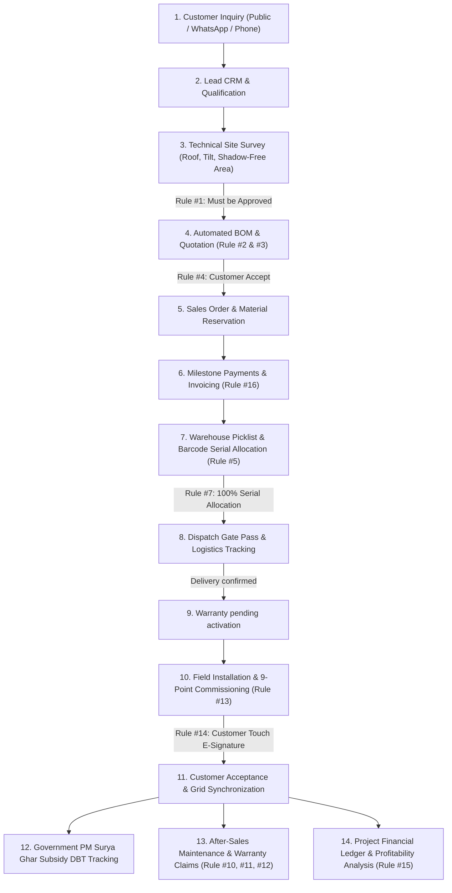

# AARKA — Solar Operations, Simplified.
> **Enterprise Rooftop Solar Installation & Lifecycle Management Platform**

[](https://fastapi.tiangolo.com)
[](https://react.dev)
[](https://www.postgresql.org)
[](https://vitejs.dev)
[](LICENSE)

---

## ☀️ 1. Executive Summary

AARKA is a solar operations application with a React/Vite frontend and a FastAPI backend backed by PostgreSQL. Its workflows cover customer enquiries, sales, surveys, inventory, dispatch, installation, service, finance, and reporting.

The figures and government-scheme details shown in the application must be confirmed against current business records and official sources. Development seed data is not production data.

---

## 🔄 2. End-to-End Business Lifecycle

The entire lifecycle is connected through enforced database relationships and transaction boundaries:



### Detailed Lifecycle Stages:
1. **Customer Inquiry**: Captured via Public Portal (`/enquiry`), WhatsApp, phone, or referral. Deduplicated against existing client records.
2. **Lead CRM**: Tracked across pipeline stages (`NEW` $\to$ `CONTACTED` $\to$ `QUALIFIED` $\to$ `SURVEY_SCHEDULED` $\to$ `WON`). Opportunity sizing and follow-up logging.
3. **Technical Site Survey**: Field surveyor records roof area, shadow-free area, azimuth orientation, tilt angle, cable run distance, and DISCOM sanctioned load.
4. **BOM & Quotations**: BOM calculations support package sizing. Survey approval is required before quote finalization.
5. **Sales Orders & Reservations**: Customer quotation acceptance automatically instantiates a `SalesOrder` and reserves BOM equipment in warehouse inventory.
6. **Milestone Payments**: Tracks advance, intermediate delivery, and final commissioning payments with overpayment rejection logic.
7. **Serialized Inventory**: Barcode unit tracking for high-value components (modules, inverters, batteries) preventing duplicate serials.
8. **Warehouse Dispatch**: Strict gate pass verification requiring 100% serial number assignment before warehouse release.
9. **Delivery & Warranty**: Delivery confirmation records warranty activation as pending; coverage is not represented as active until verified.
10. **Field Installation**: Mobile-friendly 9-point checklist completion verified on-site.
11. **Handover & E-Signature**: Customer electronic signature captured on HTML5 canvas before job sign-off.
12. **Government Subsidies**: National portal file tracking, DISCOM net metering inspection scheduling, and DBT disbursement verification.
13. **After-Sales Service**: Automatic warranty coverage check (₹0 for active units, estimates for expired units) and serialized equipment replacement workflow.
14. **Finance & Profitability**: Live calculation of recognized revenue minus BOM costs, technician labor, and recorded expenses.

---

## 🏛 3. System Architecture

AARKA uses a decoupled client-server architecture:

```mermaid
graph TB
    subgraph Client["Presentation Tier (React 18 + Vite)"]
        UI["Enterprise SaaS Dashboard (Desktop / Tablet)"]
        MobileUI["Field Mobile Views (Technicians & Surveyors)"]
        PublicForm["Public Inquiry Landing Page (/enquiry)"]
    end

    subgraph API["Application Tier (FastAPI + Python)"]
        AuthModule["JWT Security & Resource/Action RBAC"]
        RuleEngine["Business Workflow Rules"]
        BOMEngine["Dynamic Solar BOM Calculator"]
        REST["Modular REST API"]
    end

    subgraph Data["Persistence Tier (PostgreSQL 16)"]
        DB[("PostgreSQL")]
        Alembic["Alembic Migration Engine"]
        Storage["Local File Store (backend/uploads/)"]
    end

    Client -->|HTTP / JSON (Vite /api Proxy)| REST
    REST --> AuthModule
    AuthModule --> RuleEngine
    RuleEngine --> BOMEngine
    REST -->|SQLAlchemy 2.0 ORM| DB
    REST --> Storage
```

---

## ⚖️ 4. Business Workflow Overview

The backend exposes workflows for:

- Customer enquiries, leads, and customer records.
- Site surveys, packages, BOM calculations, quotations, and sales orders.
- Pending and verified payments.
- Inventory, serial tracking, dispatch, and delivery confirmation.
- Technician profiles, availability, installation scheduling, and completion.
- Warranties, service tickets, suppliers, finance, subsidies, and reports.

These workflows are enforced by API validation and PostgreSQL transactions where implemented. Check the router and model code for current behavior; this overview is not a claim that every end-to-end business rule is complete or independently verified.

| Rule # | Business Constraint | Technical Enforcement Mechanism | Source File |
| :--- | :--- | :--- | :--- |
| **Rule 1** | Quotes cannot be finalized without an approved site survey. | Checks `survey.approval_status == 'APPROVED'`; raises `HTTP 400` if pending or rejected. | `quotations.py` |
| **Rule 2** | Automatically calculate BOM with correct ratios for panels, inverters, structures, cables, and protection. | Dynamic calculation sizing panel count ($\lceil \text{capacity} \times 1000 / 550 \rceil$), matching inverter kW, structure sets, and 30m cable factor. | `bom.py` |
| **Rule 3** | Enforce the configured initial payment requirement. | Payment verification checks the configured initial advance and contract ceiling. | `payments.py` |
| **Rule 4** | Quotation acceptance automatically creates Sales Order and reserves inventory. | Transitions quote to `ACCEPTED`, instantiates `SalesOrder`, creates `order_items`, and increments `reserved_quantity` in `inventory_items`. | `quotations.py` |
| **Rule 5** | Duplicate serial numbers must be rejected. | Unique database index on `serialized_equipment.serial_number` + validation check in API. | `serials.py` |
| **Rule 6** | Inventory cannot be adjusted to negative quantity. | Database check constraint + `inventory.py` check `if new_quantity < 0: raise HTTPException(400)`. | `inventory.py` |
| **Rule 7** | Dispatch requires 100% of serialized items allocated to order. | Matches order BOM requirements against allocated `serialized_equipment`. Rejects gate pass if incomplete. | `dispatches.py` |
| **Rule 8** | Delivery confirmation must not claim unverified coverage. | Creates warranty records in a pending-activation state. | `dispatches.py` |
| **Rule 9** | Warranty dates use product warranty duration. | Computes the end date using the configured product warranty term; missing terms are rejected. | `dispatches.py` |
| **Rule 10** | Service complaints for active warranties have ₹0 customer charges. | Evaluates complaint date against warranty validity; sets `is_under_warranty=True`, `estimated_cost=0.0`. | `service.py` |
| **Rule 11** | Service complaints for expired warranties generate customer estimate. | When warranty is expired, sets `is_under_warranty=False` and generates repair estimate. | `service.py` |
| **Rule 12** | Component replacement under warranty updates serial number records. | Marks old serial as `RETURNED_DEFECTIVE`, sets new serial as `ALLOCATED_CUSTOMER`, and updates warranty record. | `service.py` |
| **Rule 13** | Installation cannot be completed without 9-point checklist completion. | Verifies all 9 checklist booleans (`panels_mounted`, `voc_isc_verified`, etc.) are `True`. | `installations.py` |
| **Rule 14** | Installation completion requires customer acceptance signature. | Requires customer touch signature token / base64 data URL before completing handover. | `installations.py` |
| **Rule 15** | Project profitability must account for material costs, labor, and overheads. | Computes: $\text{Gross Profit} = \text{Recognized Revenue} - (\text{BOM Cost} + \text{Labor Cost} + \text{Expenses})$. | `finance.py` |
| **Rule 16** | Payments require authorized verification and must remain within the order contract ceiling. | Verification checks the order balance before marking a payment complete. | `payments.py` |

---

## 🗄 5. Database Schema

The PostgreSQL schema is managed through **Alembic** migrations. Domain models are located in:

```
backend/app/models/
├── user.py            -> users, audit_logs
├── customer.py        -> customers
├── survey.py          -> site_surveys, survey_photos, technicians
├── product.py         -> products, solar_packages, bom_templates
├── commercial.py      -> quotations, quotation_items, sales_orders, order_items, payments
├── inventory.py       -> inventory_items, stock_movements, serialized_equipment, warehouse_dispatches
├── installation.py   -> installation_jobs, installation_photos
├── service.py         -> warranty_records, service_tickets
├── finance.py         -> project_expenses, commercial_invoices
└── subsidy.py         -> subsidy_applications
```

---

## 💻 6. Frontend Architecture & Design System

The frontend is built using **React 18** and **Vite** following an enterprise SaaS design philosophy:

- **Branding**: Forest green primary palette (`#0c2318`, `#1b4d36`, `#2e8b60`), warm background tones (`#f9f9f6`), and muted amber accents.
- **Typography**: Clean, professional typography (`Plus Jakarta Sans` for body, `Space Grotesk` for data/numbers).
- **Reusable Components**: `ApplicationLayout`, `Sidebar`, `Topbar`, `DataTable`, `StatCard`, `StatusBadge`, `Modal`, and `SignatureCanvas`.
- **Visualization**: Interactive operational charts via **Recharts** (monthly revenue trends, conversion funnel, project status distributions).
- **Mobile Field Utility**: Responsive touch-friendly layout for site surveys and installation checklists.

---

## 👥 7. Role-Based Access Control (13 Roles)

The backend enforces resource/action permissions for these employee roles:

- **Director / Super Admin** — company-wide administration and oversight.
- **Operations Manager** — cross-department project coordination.
- **Sales Manager** and **Sales Executive** — sales pipeline and customer workflows.
- **Warehouse Manager**, **Dispatch Staff**, and **Storekeeper** — inventory and dispatch workflows.
- **Finance Manager** — payments and financial records.
- **Installation Manager**, **Site Survey Engineer**, and **Solar Technician** — survey and installation workflows.
- **Service Manager** and **Support Executive** — warranty and customer service workflows.

Employee accounts are managed from Team Management. The demo-data seed does not create login accounts; create or provision accounts separately.

---

## ⚡️ 8. Local Setup & Execution Guide

### Prerequisites
- Python 3.9+
- Node.js 18+ & npm
- PostgreSQL 16 (Local instance or Docker)

### 1. Environment Files
```bash
cp .env.example .env
cp backend/.env.example backend/.env
# Set matching local PostgreSQL credentials and a unique JWT secret of at least
# 32 characters in backend/.env.
```

### 2. Install Dependencies and Setup Database
```bash
python3 -m venv .venv
./.venv/bin/python -m pip install -r backend/requirements.txt
cd frontend && npm install && cd ..

# Start PostgreSQL (or run via Docker)
docker compose up -d postgres

# Apply migrations
cd backend && ../.venv/bin/alembic upgrade head
```

Apply Alembic migrations before starting the API. The API does not create or alter the database schema at startup.

Demo data is optional. Run the seed only after confirming the configured database is disposable:

```bash
cd backend
AARKA_SEED_DEMO_DATA=1 ../.venv/bin/python seed_data.py
```

### 3. Launch Development Servers
```bash
# Terminal 1: Launch FastAPI Backend (Port 8000)
cd backend && ../.venv/bin/python -m uvicorn main:app --host 127.0.0.1 --port 8000 --reload

# Terminal 2: Launch Vite Frontend (Port 5173)
cd frontend && npm run dev
```

### 4. Active Endpoints
- **AARKA Web App**: `http://localhost:5173/`
- **Public Inquiry Portal**: `http://localhost:5173/enquiry`
- **Swagger API Docs**: `http://127.0.0.1:8000/docs`
- **Detailed API Documentation**: [docs/API_DOCUMENTATION.md](docs/API_DOCUMENTATION.md)

---

## 🧪 9. Automated Testing & Verification

Backend tests include integration workflows and require PostgreSQL. They create test users and records. Set `DB_NAME` to a disposable database name containing `test` in `backend/.env`; the test runner also requires the explicit `AARKA_TEST_DATABASE=1` opt-in.

```bash
cd backend
AARKA_TEST_DATABASE=1 PYTHONPATH=. ../.venv/bin/python -m pytest -v
```

---

## Operational Modules

The application includes workflows for leads, customers, surveys, products, BOM, quotations, orders, payments, inventory, serials, dispatches, technicians, installations, warranties, service, suppliers, finance, subsidies, reports, dashboards, and team access management.
